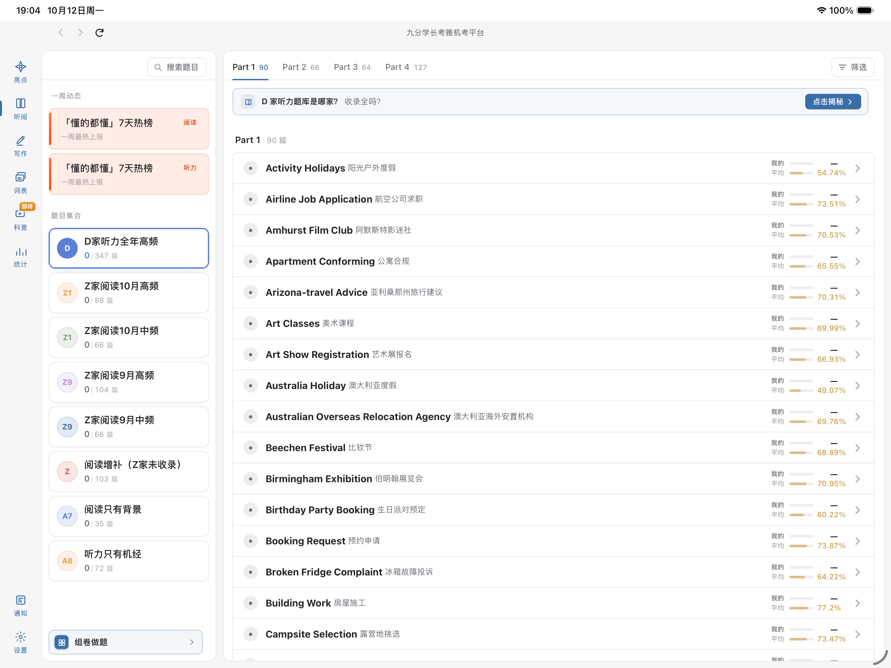

# 九分学长 iPad 自用适配版

> **非官方个人项目。** 本项目由用户自发、无偿制作，不代表或隶属于「九分学长」及其开发者；未获得官方背书。本仓库设为 **Private**，用于个人保存和下载自用安装包。

如原作者或其他权利人对本适配或其中内容有任何异议，请通过 GitHub 联系仓库所有者；收到通知后会及时核查并按要求删除。原应用、题库、文字、图片、音频、商标及其他第三方内容的权利仍归各自权利人所有。本项目不授予这些内容任何再分发许可，也请勿将 Release 安装包转发或公开镜像。

## 适配范围

- iPad 全屏横屏使用；只声明 `Landscape Left` 与 `Landscape Right`，即横屏状态下可翻转 180°；**不支持竖屏界面**。
- 禁止网页双击/捏合缩放，并限制页面整体横向溢出。
- HTTPS 外链交由系统浏览器打开。
- 当前已通过 13 英寸 iPad Pro 模拟器的横屏基础验收。2021 款 11 英寸 iPad 真机尚未验收，不能据此承诺所有尺寸与题型都已验证。

模拟器的机身方向可以被手动旋转；这不等于应用支持竖屏。将模拟器强制设为竖屏时，iOS 可能以黑边/兼容画布显示仍保持横屏的应用。验证本项目方向时，请在模拟器 **Device → Orientation** 中选择 `Landscape Left` 和 `Landscape Right`。

## 下载与安装

从本仓库的 **Releases** 下载 `九分学长雅思-iPad自用版-双向横屏.ipa`。仓库为 Private，需使用获授权的 GitHub 账号登录后访问。此 IPA 未使用开发者证书签名，不是 App Store / TestFlight 安装包；安装方式取决于设备系统版本和用户可用的侧载环境，请自行确认兼容性。

## 验收截图

## 版本记录

- `2026-10-12`：双向横屏版本；13 英寸模拟器显示题目列表与统计列。11 英寸真机测试待补。

## 权利与许可

本仓库没有对原应用或其资源授予开源、复制或再分发许可。Release 仅供仓库所有者个人保存和使用；若无明确授权，请勿公开传播。若后续补充仅针对本项目原创代码的许可，会在独立文件中说明。
